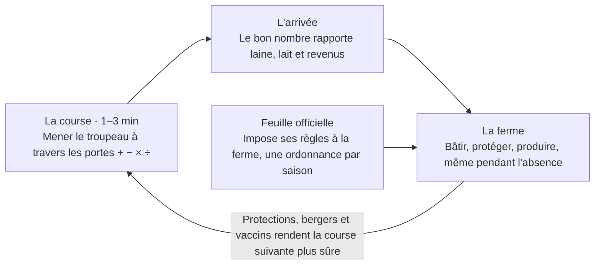
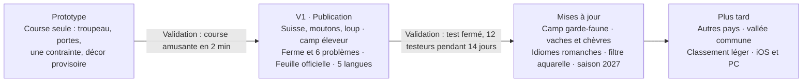

# Loup & Laine — Cahier des charges

Version 0.1 · 15 octobre 2026 · Florian

> Version initiale exportée du document « Loup & Laine — Cahier des charges » (Claude Docs) le 15.10.2026. Depuis, **ce fichier fait foi** : toute évolution se fait ici, avec une entrée dans `docs/DECISIONS.md`.

## Vision et principes

Loup & Laine est un jeu Android payant (1 à 3 CHF), sans publicité, où l'on mène un troupeau vers l'alpage et développe sa ferme de montagne. Il se joue par sessions de 1 à 3 minutes, en solo et hors ligne.

- **Modèle** : achat unique. Pas de publicité, pas de pay-to-win : rien ne s'achète pour prendre l'avantage.
- **Solo et hors ligne** : tout tourne sur le téléphone, sans serveur ni compte, donc sans frais récurrents.
- **Petits moments** : des courses courtes, et une ferme qui continue de vivre pendant l'absence du joueur.
- **Ancré dans le réel** : les problèmes des éleveurs suisses de 2026 deviennent des mécaniques de jeu.
- **Ton** : doux, drôle, clin d'œil à la Suisse. Le jeu ne prend pas parti dans le débat sur le loup.

## Concept et boucle de jeu

Le joueur alterne courses courtes et gestion de sa ferme : chaque course rapporte de quoi bâtir et protéger, et la ferme rend la course suivante plus sûre.

La Feuille officielle vient bousculer cette boucle à chaque saison. En V1, seul le camp éleveur est jouable ; le camp garde-faune viendra dans une mise à jour.

## La course

Une course dure 1 à 3 minutes : le joueur guide son troupeau de moutons vers l'alpage en choisissant ses portes. Le but n'est pas d'arriver le plus nombreux possible, mais avec **le bon nombre**.

- **Portes** : chaque porte applique une opération au troupeau (+, −, ×, ÷). L'écran est en portrait, jouable à une main : le joueur glisse à gauche ou à droite pour choisir.
- **Contraintes de nombre** :
  - un pont cède au-delà d'un maximum ;
  - un pâturage ou un enclos ne nourrit qu'un nombre limité de bêtes ;
  - une source n'abreuve qu'un nombre limité de bêtes ;
  - un loup ne renonce que si le troupeau est assez nombreux et protégé.
- **Diviseurs utiles** : réduire le troupeau au bon moment devient un choix, pas une punition.
- **Arrivée** : le nombre de moutons arrivés, comparé à la cible de la course, donne les récompenses (laine, lait, revenus).
- **Protections** : les chiens, clôtures et bergers acquis à la ferme réduisent les pertes aux portes « loup ».

## L'alpage et la ferme

Entre les courses, le joueur développe sa ferme de montagne avec ce qu'il a ramené. La ferme continue de produire pendant son absence : à la réouverture, le jeu calcule ce qui s'est passé à partir de l'heure, sans serveur.

| Élément | Rôle dans le jeu |
| --- | --- |
| Bergerie | Capacité du troupeau |
| Fromagerie | Transforme le lait en fromage de brebis, principale source de revenus |
| Clôtures | Protection contre le loup ; hauteur imposée par les ordonnances |
| Parc de nuit | Met le troupeau à l'abri la nuit |
| Chiens de protection | Protection forte, mais gênent les randonneurs |
| Bergers | Protection et soins ; rares, à recruter et former |
| Citernes | Réserve d'eau pour les sécheresses |
| Buvette | Revenus du tourisme, sensibles à la réputation auprès des randonneurs |
| Classeur | Toutes les ordonnances en vigueur, consultables à tout moment |

Les coûts, capacités et durées de production seront fixés pendant l'équilibrage.

## Problèmes réels intégrés

La V1 reprend six difficultés que vivent les éleveurs de l'arc alpin en 2026, chacune traduite en une mécanique. Le jeu montre les contraintes de l'éleveur sans désigner de coupable.

| Problème réel | Mécanique dans le jeu |
| --- | --- |
| **Loup** : environ 350 loups et 40 meutes en Suisse début 2026 ; espèce protégée, régulée par des tirs ([OFEV](https://www.bafu.admin.ch/fr/loup)) | Portes « loup » pendant la course, moins sévères si le troupeau est protégé |
| **Indemnisation conditionnelle** : une chèvre tuée près d'Einsiedeln en août 2026 n'a pas été reconnue, la protection étant incomplète ([canton de Schwytz](https://www.sz.ch/kanton/medien-und-datenschutz/medienmitteilungen/detailseite.html/8756-8757-8803-10391-10392/news/25814/print/html)) | Une bête perdue n'est remboursée que si la protection exigée était en place |
| **Sécheresse** : en août 2026, l'armée ravitaille en eau par hélicoptère des alpages fribourgeois ([Blick](https://www.blick.ch/fr/suisse/romande/larmee-en-soutien-contre-la-secheresse-les-vaches-des-alpages-fribourgeois-recoivent-de-leau-par-helico-id22155161.html)) ; une vache boit jusqu'à 100 l par jour ([source](https://enjoymedia.ch/fr/blog/alpabzug-trockenheit-alpkaese-2026-08-24)) | Jauge d'eau, portes « source », hélicoptère en secours coûteux ; jauge vide = désalpe anticipée |
| **Langue bleue** : vaccination des bovins, moutons et chèvres recommandée pour 2026 ([canton du Valais](https://www.vs.ch/web/scav/actualit%C3%A9s)) | Décider de vacciner avant la saison ; sinon, portes « moucherons » pendant la course |
| **Manque de bergers** : le personnel formé à la protection des troupeaux manque ([Land Tirol](https://www.tirol.gv.at/meldungen/meldung/almsaison-2025-positive-entwicklungen-getruebt-durch-steigende-risszahlen/)) | Recruter et former des bergers à la ferme |
| **Chiens et randonneurs** : la cohabitation entre protection et tourisme est un enjeu reconnu ([CIPRA](https://www.cipra.org/media/files/cipra-d_positionspapier_wolf_2025.pdf/@@download/file/CIPRA%20D_Positionspapier_Wolf_2025.pdf)) | Trop de chiens fait baisser la réputation et les revenus de la buvette |

Chaque type de bétail ajouté plus tard aura son ennemi principal : le loup pour les moutons, la sécheresse pour les vaches, l'évasion pour les chèvres.

## La Feuille officielle et le parlement

Chaque saison, une nouvelle ordonnance du parlement fictif de la vallée arrive à la ferme ; le joueur qui ne la lit pas risque de ne pas être indemnisé. C'est le clin d'œil à la politique qui pèse sur la vie de l'éleveur.

Exemple de ton :

> *Ordonnance 12bis (révisée) : dès la saison prochaine, les clôtures de protection mesurent au moins 1,10 m, sauf le long des sentiers balisés, où elles ne dépassent pas 0,90 m. Délai transitoire : une saison.*

- **Humeur du parlement** : une jauge qui bouge selon les événements de la vallée. Beaucoup d'attaques durcissent la protection, une sécheresse ouvre des subventions pour les citernes, des plaintes de randonneurs encadrent les chiens.
- **Règles bizarres, mais solubles** : les contradictions sont assumées (haute pour le loup, basse pour les sentiers), mais ont toujours une solution.
- **Piège loyal** : chaque règle est annoncée avec un délai transitoire et reste consultable dans le classeur. Une ferme non conforme lors d'une attaque n'est pas indemnisée, mais une règle seule ne fait jamais perdre la partie.
- **Neutralité** : parlement fictif, sans vrais partis ni vrais politiciens. L'humour vise les procédures (délais, révisions, « bis » et « ter »), pas un camp.
- **Technique** : chaque ordonnance est un fichier de données (condition, effet, délai, texte en cinq langues). On en ajoute sans toucher au code.
- **Plus tard** : les communautés éleveurs et garde-faune pourront tirer l'humeur du parlement chacune de son côté.

## Langues

Le jeu sort en cinq langues, avec un titre qui garde son allitération dans chacune.

| Langue | Titre | Remarques |
| --- | --- | --- |
| Français | Loup & Laine | Langue de rédaction |
| Allemand | Wolf & Wolle | Orthographe suisse, sans ß |
| Italien | Lupo & Lana | Italien de Suisse |
| Romanche | Luf & Launa | Rumantsch grischun ; relecture par un locuteur natif obligatoire |
| Anglais | Wolf & Wool | Marché international |

Google Play accepte une fiche en romanche (code rm) et un titre différent par langue ([Google](https://support.google.com/googleplay/android-developer/answer/9844778?hl=en)).

- **Fichiers de traduction dès le premier jour** : aucun texte écrit en dur dans le code.
- **Option « Suisse authentique »** (activée par défaut ; le tutoriel explique comment la désactiver dans les paramètres) : certains textes d'ambiance apparaissent dans une autre langue nationale. Panneaux, titres de journaux, remarques des villageois ; une ordonnance peut porter la mention « traduction officielle à suivre ».
- **Le touriste égaré** : il débarque à l'alpage, parle une autre langue, demande son chemin, photographie les chiens. Bien accueilli, il fait marcher la buvette ; mal accueilli, il laisse un avis grincheux, dans sa langue.
- **Règle d'or** : une information nécessaire pour jouer est toujours consultable dans la langue du joueur (classeur ou bouton « traduire »).
- **Plus tard** : clins d'œil dans les idiomes romanches (vallader, sursilvan…), relus par un natif.

## Direction artistique

Le style est un low poly doux : formes 3D simples, palette pastel, lumière chaude, brume sur les montagnes. Il donne une ambiance calme sans exiger de peindre chaque élément à la main.

- **Base d'assets** : packs gratuits de Quaternius sous licence CC0, utilisables dans un jeu payant. Un pack d'animaux de ferme animés avec mouton et vache ([pack 1](https://opengameart.org/node/85047)), un autre avec loup et chien ([pack 2](https://opengameart.org/content/animated-animales-low-poly)).
- **Éléments suisses** : chalets, fromagerie, cloches et clôtures retouchés ou modélisés dans Blender.
- **Pas de violence graphique** : une attaque se montre par des moutons qui s'enfuient ou disparaissent, jamais par du sang. C'est plus agréable, et ça compte pour la classification d'âge.
- **Pas de référence à un studio** : le style ne se réclame d'aucune œuvre existante.
- **Plus tard** : un filtre aquarelle (shader imitant le grain du papier) comme finition.

## Technique

Le jeu est développé avec Godot 4 en GDScript, un moteur gratuit et open source, sans commission ; la version 4.7 est sortie en juin 2026 ([StraySpark](https://www.strayspark.studio/blog/tag/android)).

- **Pourquoi Godot** : un vrai moteur de jeu (scènes, 3D, animations, son, tactile, traduction, export Android). GDScript ressemble à Python. Le même projet pourra viser iOS, PC (Steam) et le web.
- **Exigence Google Play** : les nouvelles apps et les mises à jour doivent cibler Android 16, API 36 ([GameDev.net](https://gamedev.net/news/5242/)).
- **Tout en local** : sauvegarde sur le téléphone, aucun serveur, aucun compte, aucune donnée collectée. La déclaration « sécurité des données » du Play Store reste simple.
- **Code et dépôt** : dépôt GitHub ; scènes et scripts en fichiers texte, versionnés. Claude Code écrit et modifie le code.
- **Tests** : dans l'éditeur Godot sur le PC personnel, puis sur téléphone via USB.
- **Données de jeu** : ordonnances, portes, bâtiments et textes dans des fichiers de données, pour ajouter du contenu sans toucher au code.

## Publication sur Google Play

Sur un compte personnel neuf, le lancement prend environ trois semaines après la fin du développement, à cause du test fermé obligatoire ([Choicely](https://www.choicely.com/blog/google-play-12-tester-rule)).

| Étape | Détail |
| --- | --- |
| Compte développeur | Frais uniques de 25 USD et vérification d'identité ([Google](https://support.google.com/googleplay/android-developer/answer/14659200?hl=en-AU)) |
| Compte marchand | Obligatoire pour une app payante ([AppMySite](https://www.appmysite.com/support/?p=59945)) |
| Test fermé | Compte personnel créé après le 13 novembre 2023 : au moins 12 testeurs inscrits sans interruption pendant les 14 derniers jours avant de demander l'accès à la production ([Google](https://support.google.com/googleplay/android-developer/answer/14151465?hl=en-GB)). Les comptes organisation en sont dispensés ([Choicely](https://www.choicely.com/blog/google-play-12-tester-rule)). |
| Commission | 15 à 30 % de chaque vente ; Google gère la TVA suisse en tant que vendeur ([Magic Heidi](https://magicheidi.ch/en/integrations/play-store)) |

Si le nombre de testeurs passe sous 12, le compteur repart à zéro ([ExtendsClass](https://extendsclass.com/blog/google-plays-closed-testing-requirement-what-developers-need-to-know-in-2026)) : viser 15 à 20 testeurs fiables.

**Prix** : cible de 2 CHF, à confirmer avant le test fermé. Une app payante peut devenir gratuite, mais une app gratuite ne redevient jamais payante ; soldes et codes promo restent possibles ([Google](https://support.google.com/googleplay/android-developer/answer/6334373)).

**Compte** : personnel, faute d'entreprise. Google le prévoit pour les amateurs, avec les mêmes fonctions que le compte organisation, qui exige un numéro D-U-N-S ([Google](https://support.google.com/googleplay/android-developer/answer/13634885)). Une app payante oblige à afficher l'adresse complète du développeur sur Google Play ([Google](https://support.google.com/googleplay/android-developer/answer/13634081)).

## Périmètre V1 et feuille de route

La V1 se limite à la Suisse, aux moutons, au loup et au camp éleveur ; tout le reste arrive ensuite par mises à jour.

Les phases ne sont pas encore datées : le calendrier sera fixé après le prototype. « Ordonnance 12bis » pourra nommer la première grosse mise à jour, et « Compte les moutons » un mode de jeu.

## Méthode de développement

Le premier jalon est un prototype de la course seule, pour vérifier qu'elle est amusante en deux minutes ; la ferme vient ensuite.

1. Créer le dépôt GitHub avec ce cahier des charges en `docs/SPEC.md`, un journal `docs/DECISIONS.md` et un `CLAUDE.md`.
2. Prototyper la course : troupeau, portes, une contrainte de nombre, écran d'arrivée, graphismes provisoires.
3. Tester sur téléphone et ajuster jusqu'à ce que la course soit amusante.
4. Construire la ferme et la boucle complète, puis la Feuille officielle, les langues et l'habillage graphique.
5. Lancer le test fermé Google Play, puis publier.

Règles du dépôt :

- `docs/SPEC.md` fait foi. Une décision qui le change le met à jour dans le même commit, avec une entrée dans `docs/DECISIONS.md`.
- `CLAUDE.md` rappelle les conventions : textes uniquement via les fichiers de traduction, contenu dans des fichiers de données, un commit par changement cohérent.

## Questions ouvertes

- [ ] Prix : cible de 2 CHF, à confirmer avant le test fermé.
- [x] Compte développeur : personnel, faute d'entreprise. L'adresse complète du développeur sera visible sur la fiche Google Play.
- [ ] Vérifier le nom : recherche Play Store, registres Swissreg et EUIPO. Un visual novel « Wolf's Wool » existe déjà sur Google Play. Responsable : Florian
- [ ] Trouver un relecteur natif pour le romanche et faire valider « Luf & Launa ». Responsable : Florian
- [ ] Recruter 15 à 20 testeurs pour le test fermé (plus tard).
- [x] Orientation : portrait, jouable à une main.
- [x] Option « Suisse authentique » : activée par défaut ; le tutoriel explique comment la désactiver.
- [ ] Équilibrage : durées, coûts, capacités, cibles des courses (pendant le développement).

## Références

- **Loup** : [OFEV – Le loup](https://www.bafu.admin.ch/fr/loup) · [OFEV – Régulation 2025-2026](https://www.bafu.admin.ch/fr/newnsb/l4_reSakNtA9coSPfKgSE) · [La Télé – Autorisations de tirs, automne 2026](https://latele.ch/articles/nombre-d-autorisations-de-tirs-preventifs-du-loup-en-forte-hausse) · [Radio Lac – Demande du Valais](https://www.radiolac.ch/?p=457420)
- **Protection des troupeaux** : [Canton de Schwytz – Einsiedeln](https://www.sz.ch/kanton/medien-und-datenschutz/medienmitteilungen/detailseite.html/8756-8757-8803-10391-10392/news/25814/print/html) · [Canton des Grisons – Bilan](https://www.gr.ch/DE/Medien/Mitteilungen/MMStaka/2022/Seiten/2022122101.aspx) · [Land Tirol – Almsaison 2025](https://www.tirol.gv.at/meldungen/meldung/almsaison-2025-positive-entwicklungen-getruebt-durch-steigende-risszahlen/) · [CIPRA – Position sur le loup](https://www.cipra.org/media/files/cipra-d_positionspapier_wolf_2025.pdf/@@download/file/CIPRA%20D_Positionspapier_Wolf_2025.pdf)
- **Sécheresse** : [Blick – Hélicoptères pour les alpages](https://www.blick.ch/fr/suisse/romande/larmee-en-soutien-contre-la-secheresse-les-vaches-des-alpages-fribourgeois-recoivent-de-leau-par-helico-id22155161.html) · [Sécheresse et fromage d'alpage 2026](https://enjoymedia.ch/fr/blog/alpabzug-trockenheit-alpkaese-2026-08-24)
- **Santé animale** : [Canton du Valais – Service vétérinaire](https://www.vs.ch/web/scav/actualit%C3%A9s)
- **Langues** : [DFAE – Emna rumantscha](https://www.eda.admin.ch/de/emna-rumantscha-rm) · [Google Play – Langues des fiches](https://support.google.com/googleplay/android-developer/answer/9844778?hl=en)
- **Technique et assets** : [StraySpark – Godot 4.7](https://www.strayspark.studio/blog/tag/android) · [GameDev.net – Exigence Android 16](https://gamedev.net/news/5242/) · [Quaternius – Animaux de ferme](https://opengameart.org/node/85047) · [Quaternius – Loup et chien](https://opengameart.org/content/animated-animales-low-poly)
- **Publication** : [Google – Test fermé](https://support.google.com/googleplay/android-developer/answer/14151465?hl=en-GB) · [Google – Frais et commission](https://support.google.com/googleplay/android-developer/answer/14659200?hl=en-AU) · [Google – Prix des apps](https://support.google.com/googleplay/android-developer/answer/6334373) · [Google – Types de compte](https://support.google.com/googleplay/android-developer/answer/13634885) · [Choicely – Règle des 12 testeurs](https://www.choicely.com/blog/google-play-12-tester-rule) · [ExtendsClass – Test fermé 2026](https://extendsclass.com/blog/google-plays-closed-testing-requirement-what-developers-need-to-know-in-2026) · [AppMySite – Compte marchand](https://www.appmysite.com/support/?p=59945) · [Magic Heidi – Play Store en Suisse](https://magicheidi.ch/en/integrations/play-store)
- **Nom** : [Wolf's Wool (visual novel existant)](https://knickknackpj.itch.io/wolfswool/devlog/463029/android-version-released)
